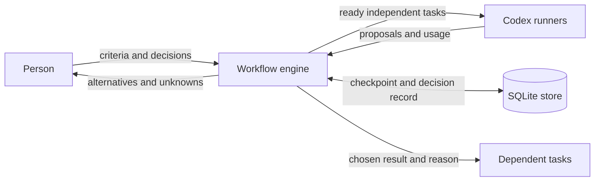

# Architecture

This describes logical responsibility. Roles are not separate OS security boundaries.

The host supplies a goal and criteria before dispatch. Each task references predecessor IDs. The engine validates this graph and records a task as running before calling its runner. Independent tasks may run concurrently. A task requiring judgment stops at `awaiting-decision`; only a matching human decision makes its selected result available downstream.

The decision includes a proposal fingerprint, the selected option, the person's reason, and a reconsideration condition. The fingerprint prevents accepting a decision prepared for different material. Revisions in the store prevent concurrent writers from silently replacing one another. Neither replaces external-service version checks.

Normal flow: pending → running → awaiting-decision → completed. A one-result draft skips the decision state. Runner errors become failed tasks, and paid work is not retried automatically. A process interrupted while a model request is running may leave a running record; the host must reconcile that request rather than treating it as safe to replay.

SQLite is the default local persistence boundary. Codex maintains its own thread history. These are different stores with different completion semantics: model completion is not adoption of a proposal, and adoption is not external execution.

The initial implementation deliberately exposes no external publication/payment/calendar tool. A host can add an executor after defining its own concrete action contract and reconciliation behavior. The host must not let a proposal-producing model bypass these boundaries through ambient tools.
